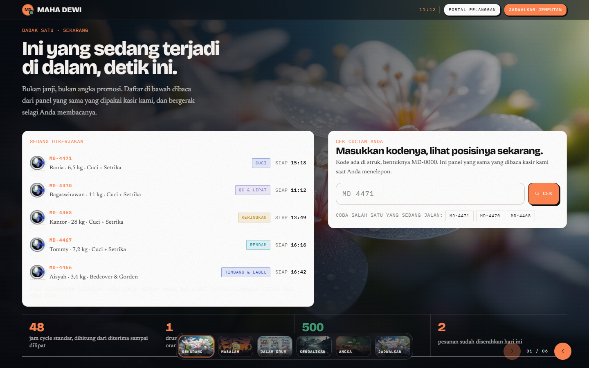
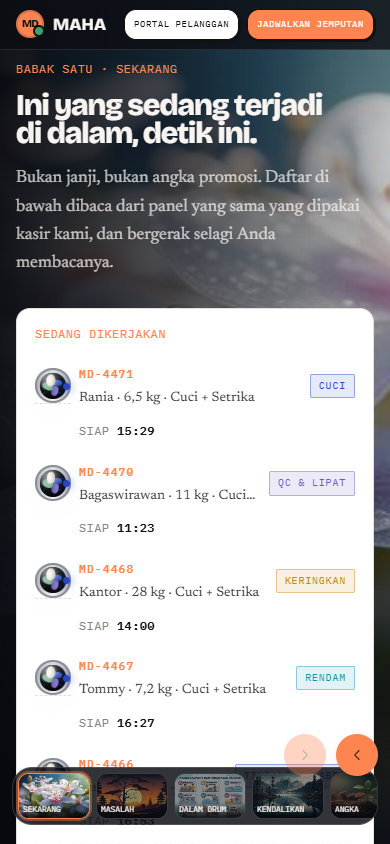
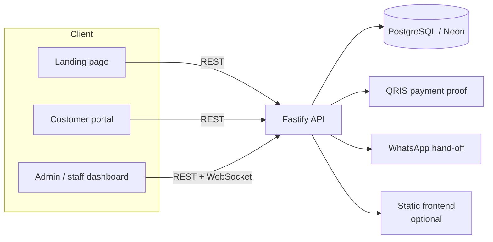

<p align="center">
  
</p>

<h1 align="center">MAHA Dewi Laundry Ops</h1>

<p align="center">
  <strong>A production laundry platform: public storefront, customer portal, and real-time operations dashboard.</strong>
</p>

<p align="center">
  <a href="https://busa-api.onrender.com/health"></a>
  <a href="LICENSE"></a>
  <a href="https://github.com/bahriayet/busa/actions/workflows/ci.yml"></a>
  
  
  
  
</p>

<p align="center">
  <a href="#screenshots">Screenshots</a> ·
  <a href="README.id.md">Bahasa Indonesia</a> ·
  <a href="https://github.com/bahriayet/busa/issues">Issues</a>
</p>

---

**MAHA Dewi Laundry Ops** brings the storefront, customer portal, and day-to-day laundry operations into one system. Customers track orders, top up a wallet, collect loyalty stamps, and pay with QRIS. Staff scan each production stage on the machine floor. Owners see the floor in real time and export reports.

The project is built for **Laundry MAHA Dewi Mataram**, Indonesia. The API is deployed on Render; the frontend is a static bundle that can be hosted on Vercel, Netlify, GitHub Pages, or served directly by the API with `BUSA_SERVE_STATIC=true`.

## Features

| Surface | What it does |
| --- | --- |
| **Public landing** | Six full-screen scenes, thumbnails, arrow and swipe navigation, keyboard support, editable background slots, and a service price rail. |
| **Customer portal** | Order tracking by code, checkout, wallet, loyalty stamps, saved addresses, QRIS payment proof, and self-service rescheduling. |
| **Operations dashboard** | Real-time machine floor, stage scanning, queue and order management, customers, services and pricing, payments, gallery, location, CSV reports, and user management. |
| **Security** | Role-based access control, per-account and per-IP login rate limits, audit logging, strict Content Security Policy, and a CORS allowlist. |
| **Accessibility** | ARIA regions and live regions, `inert` inactive slides, keyboard navigation (`←`/`→`, `PageUp`/`PageDown`, `Home`/`End`), 44 px touch targets, and `prefers-reduced-motion` support. |
| **Operations** | Health endpoint, keep-alive workflow for the free Render tier, environment-based configuration, and production-safe seeding. |

## Screenshots

Captured from the local build with sample data.

<p align="center">
  
</p>

<p align="center">
  
</p>

## Architecture



- **Frontend** — static HTML, CSS, and vanilla JavaScript with a hash router. No build step is required for the frontend.
- **Backend** — Fastify 5 with Zod type providers, JWT authentication, WebSocket broadcasts, and an event-sourced machine-floor projection.
- **Database** — PostgreSQL in production, `@electric-sql/pglite` in tests, so the test suite runs without a database server.
- **Tests** — 67 API/domain tests with `node:test`, plus Playwright end-to-end coverage for the landing page and admin flows.

## Tech stack

- **Runtime:** Node.js 24+
- **Backend:** Fastify 5, Zod, `pg`, `@fastify/jwt`, `@fastify/websocket`, `@fastify/rate-limit`, `@fastify/helmet`, `@fastify/swagger`
- **Frontend:** semantic HTML, modern CSS, vanilla JavaScript, WebSocket
- **Database:** PostgreSQL (Neon), PGlite for tests
- **Testing:** `node:test`, Playwright
- **Deployment:** Vercel (frontend), Render (API), Neon (database)

## Getting started

### Frontend only

The landing page falls back to local sample data when the API is unavailable.

```bash
git clone https://github.com/bahriayet/busa.git
cd busa
python -m http.server 4173
# open http://127.0.0.1:4173
```

### Full stack

Requirements: Node.js 24+, PostgreSQL (or a Neon database).

```bash
cd server
npm ci
cp .env.example .env
# edit .env: BUSA_DATABASE_URL, BUSA_JWT_SECRET, BUSA_SEED_PASSWORD
npm run dev
# open http://127.0.0.1:8080
```

The API serves the frontend too when `BUSA_SERVE_STATIC=true`. For a separate frontend deployment, point the `<meta name="busa-api-base">` tag in `index.html` at the API origin.

### Seed data

Production seeding creates the catalog, location, empty machines, and **one admin account** — no demo orders or customers.

```bash
cd server
BUSA_SEED_MODE=production BUSA_SEED_PASSWORD='a-strong-password' BUSA_ADMIN_NAME='Bahri' npm run db:reset
```

> The reset command deletes existing data. Change the admin password after the first login and upload real QRIS/gallery assets before accepting orders.

## Testing

```bash
cd server
npm run typecheck
npm test          # 67 API/domain tests, no database server required
```

End-to-end tests use the Microsoft Edge channel by default:

```bash
npm install
npm run test:e2e
```

On a machine without Edge, install Chromium and select it explicitly:

```bash
npx playwright install chromium
PLAYWRIGHT_CHANNEL=chromium npm run test:e2e
```

## Deployment

1. **Database** — create a Neon PostgreSQL database and copy the pooled connection string.
2. **Backend** — deploy `server/` to Render using `render.yaml`, then set `BUSA_DATABASE_URL`, `BUSA_JWT_SECRET`, `BUSA_SEED_PASSWORD`, and `BUSA_CORS_ORIGINS`.
3. **Frontend** — deploy the repository root to Vercel. Update `<meta name="busa-api-base">` in `index.html` if the API origin changes.
4. **Health check** — `GET https://busa-api.onrender.com/health`.
5. **Keep-alive** — `.github/workflows/keep-alive.yml` pings the free Render instance every five minutes. Scheduled workflows pause after 60 days of repository inactivity.

## Security

- JWT sessions with short-lived tokens; changing a password revokes existing tokens.
- Login rate limits per IP and per account.
- RBAC on every staff/admin route.
- Audit logs record actor, method, route, status, and IP — never request bodies or passwords.
- Strict CSP, `frame-ancestors 'none'`, and a CORS allowlist.
- Secrets live in environment variables; `server/.env`, `server/data/`, and backups are git-ignored.

Found a vulnerability? Please read [SECURITY.md](SECURITY.md) and report it privately instead of opening a public issue.

## Project structure

```text
index.html            SPA shell (hash router)
privasi.html          Public privacy policy
syarat.html           Public terms and conditions
css/                  Application and legal styles
js/                   Config, seed data, UI, API client, views, landing, motion
img/                  Site assets and landing slides
server/               Fastify API, database layer, seed, tests
e2e/                  Playwright tests and static test server
docs/screenshots/     README screenshots
render.yaml           Render blueprint for the API
vercel.json           Vercel configuration, including CSP
```

## Contributing

Contributions are welcome. Read [CONTRIBUTING.md](CONTRIBUTING.md) for the local setup, test commands, and pull-request checklist. By participating, you agree to the [Code of Conduct](CODE_OF_CONDUCT.md).

## License

Source code is released under the [MIT License](LICENSE). The **MAHA Dewi** name, logo, and photographic assets are not licensed for reuse; see [NOTICE](NOTICE).

---

<p align="center">
  <sub>Built and maintained by <a href="https://github.com/bahriayet">Bahri Muhammad</a> in Mataram, Indonesia.</sub>
</p>
